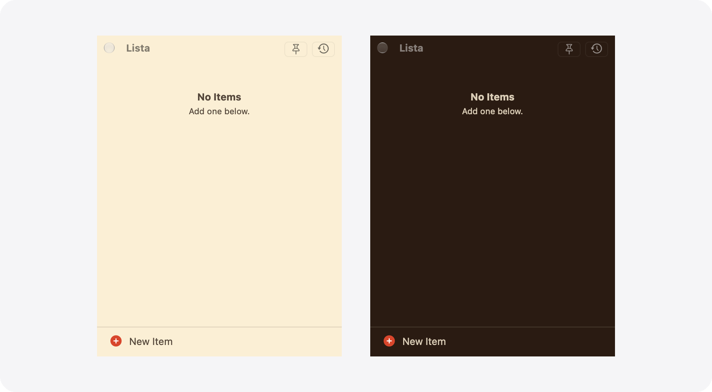

# Panelini

Small Mac apps that live in the menu bar.

Lista and Priva. One icon each, and nothing in the Dock.

## Lista

A checklist, one click away.\
*In development*

**Drops down from the menu bar**\
Unpinned, the list opens beneath the icon and closes when you click away.

**Pin**\
Keep the list floating above your windows, on every Space.

**History**\
See recent checklist changes, newest first.

**Plain text**\
The list is a Markdown file. Change it in any editor. Lista checks for changes every second.

**The icon**\
The bars count what’s open. From three up, the number sits beside them.

## Priva

Black out the screen. Bring it back.\
*In development*

**The icon**\
The eye is open while the screen is visible and closed while it’s blacked out.

**Veil**\
Blur supported text fields as you type. Move the pointer over the text to read.

**Black Out This Mac**\
Priva asks first, then tells you how to bring the screen back.

## Read more

- [Lista](docs/lista.md)
- [Priva](docs/priva.md)
