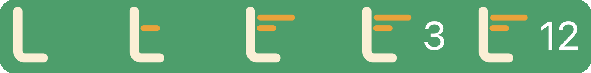
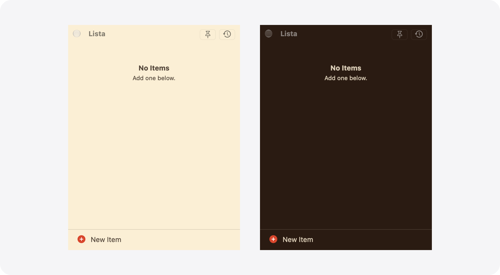

# Lista

**A checklist, one click away.**

*In development*

## The icon

The icon is Lista’s logo, and its bars count what’s open. With nothing open, it’s the L alone. One open item adds the short bar, and two add both. From three up, the number sits beside them.

Click the icon to open or close the list. Right-click it to quit.

## The list

Type in New Item and press Return to add an item. Click an item or its circle to check it off, and click again to reopen it. The title bar counts what’s done.

Lista matches the Mac’s appearance. Cream in light, charcoal in dark, with red for what’s done and gold for what’s open.

The app you’re working in stays in front, and the usual Command shortcuts work in New Item.

## Pin

Unpinned, the list drops down from the icon and closes when you click away. Pinned, it floats above other windows, on every Space, right where you leave it.

Closing the window puts Lista away. The icon stays in the menu bar.

## History

The clock button switches to History: every item added, completed, reopened, or removed, newest first, with the date and time. Click it again to return to the list.

## Plain text

The list is a Markdown file. Lista checks it every second, so a change made in any editor shows up right away and lands in History too.

- `- [ ] Item` is an open item.
- `- [x] Item` is a completed item.
- A line that starts with `#` is a heading.
- Any other line is a note.
